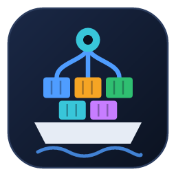
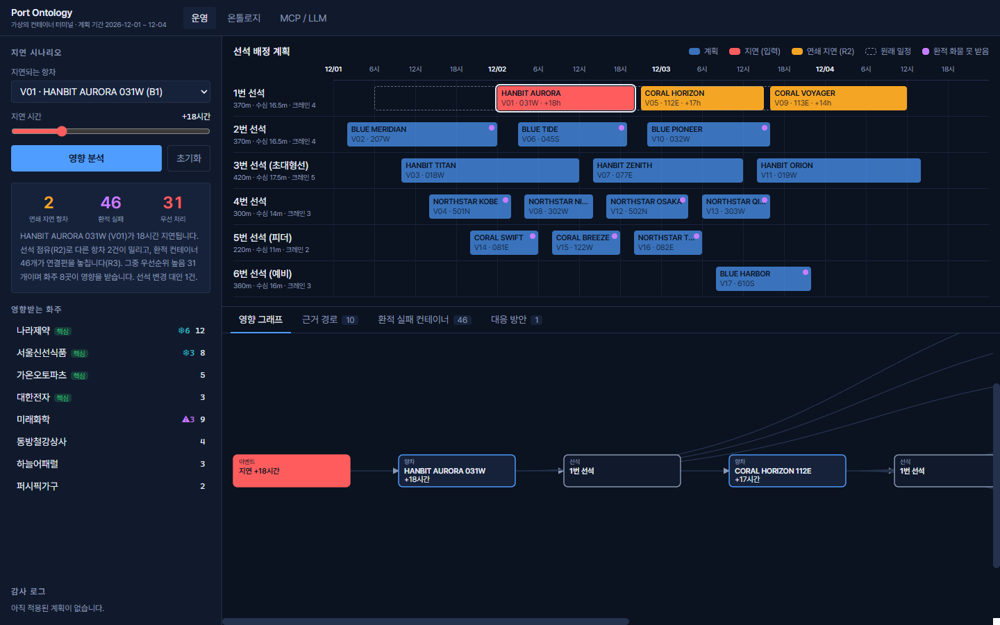

<p align="center"></p>

<h1 align="center">Port Ontology</h1>

<p align="center">
  컨테이너 터미널 운영 온톨로지와 <b>지연 영향 분석</b> 데스크톱 앱<br>
  <a href="https://ko-dex.com"><b>KODEX</b></a> 포트폴리오의 하위 프로젝트입니다.
</p>

<p align="center">
  <a href="https://ko-dex.com">KODEX 포트폴리오</a> ·
  <a href="https://github.com/naraku010/port-ontology/releases/latest">설치 파일 받기</a> ·
  <a href="docs/README.md">문서</a> ·
  자매 프로젝트 <a href="https://github.com/naraku010/corp-ontology">Corp Ontology</a>
</p>

---



설치형 실행 파일 하나가 두 가지로 동작합니다.

| 실행 방식 | 동작 |
|---|---|
| `port-ontology.exe` | 데스크톱 앱 (선석 간트 차트, 영향 그래프, 온톨로지 탐색기) |
| `port-ontology.exe --mcp` | stdio MCP 서버. 로컬 LLM CLI가 도구로 호출 |

UI와 MCP 서버는 같은 도구 디스패처를 거치므로, 사람이 누르는 버튼과 LLM이 부르는 도구가 똑같이 동작합니다.

> 자세한 문서는 [docs/](docs/README.md)에 있습니다. 구조, 온톨로지와 규칙, MCP 도구 명세, 개발 가이드, 설계 결정, 로드맵을 정리해 두었습니다.

## 핵심 시나리오

"HANBIT AURORA(V01)가 18시간 늦으면?"

1. **R2 선석 점유**: 같은 1번 선석의 V05가 17시간, V09가 14시간 밀립니다.
2. **R3 최소 환적 시간**: 환적 컨테이너 46개가 연결편을 놓칩니다.
3. **R6 우선순위**: 그중 31개는 냉동·위험물·핵심 화주 화물이라 우선 처리 대상입니다.
4. **근거 경로**: `V01 지연 → B1 (R2) → V05 → B1 (R2) → V09 → V10 환적 연결 실패 (R3)`
5. **대응 방안**: V05를 예비 선석 B6으로 옮기면 R1(제원)과 R2를 통과합니다. 적용하면 환적 실패가 46개에서 12개로 줄어듭니다.

상태 변경은 모두 `propose_*`(검증, plan_id 발급) → `apply_plan`(사용자 확인 후 반영) 2단계이며, 감사 로그가 남습니다.

## 기술 스택

- 데스크톱: Tauri 2 (Rust)
- 프론트: Next.js 16 (정적 export), Tailwind CSS 4, zustand, Pretendard
- 추론: Rust로 직접 구현한 온톨로지·규칙 엔진 (외부 그래프 DB 없음)
- LLM 연동: MCP (stdio JSON-RPC), 로컬 LLM CLI

## 설치

[Releases](https://github.com/naraku010/port-ontology/releases/latest)에서 `Port Ontology_x.y.z_x64-setup.exe`를 받아 실행합니다(Windows 10/11, WebView2 필요). 코드 서명을 하지 않아 SmartScreen 경고가 뜰 수 있습니다.

## 개발

필요: Node 20+, Rust stable, Windows는 MSVC Build Tools와 WebView2.

```powershell
npm install
npm run tauri dev      # 개발 실행
npm run tauri build    # 설치 파일 생성 (src-tauri/target/release/bundle/nsis)
```

## 테스트

```powershell
npm run test:rust      # 엔진 단위 테스트
npm run test:mcp       # MCP 서버 스모크 테스트 (먼저 cd src-tauri; cargo build)
```

## LLM CLI 연결

루트의 `.mcp.json`이 디버그 빌드를 MCP 서버로 등록합니다. 이 폴더에서 CLI를 처음 실행할 때 서버 사용을 승인하세요.
질문 예시:

- "V01이 태풍으로 18시간 늦어지면 어떤 화주에게 먼저 연락해야 해? 냉동 화물 우선으로."
- "V05를 다른 선석으로 옮길 수 있어? 안 되면 이유를 규칙으로 설명해줘."
- "서울신선식품에 보낼 지연 안내문 초안 써줘."

## 데이터

모든 선박·선사·화주 이름은 가상입니다. 계획 기간은 2026-12-01부터 4일이며 선석 6개, 항차 17건, 컨테이너 768개입니다.

## 라이선스

MIT. 번들된 Pretendard 폰트는 SIL Open Font License 1.1을 따릅니다.
